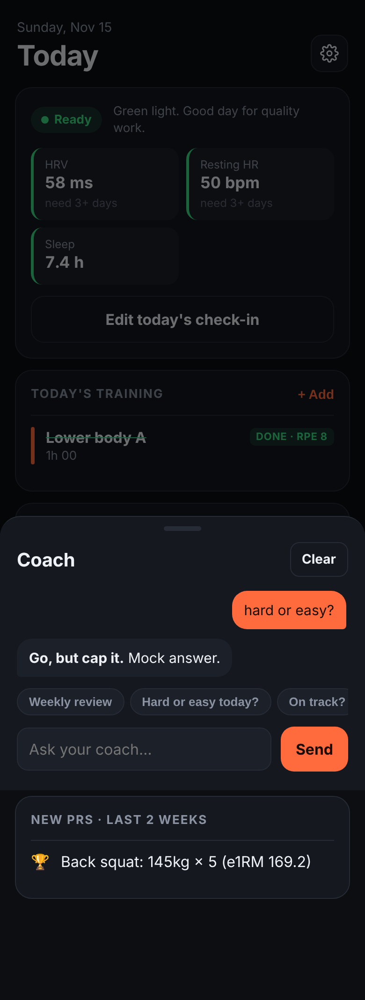
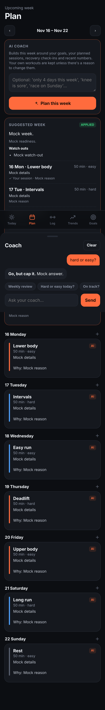
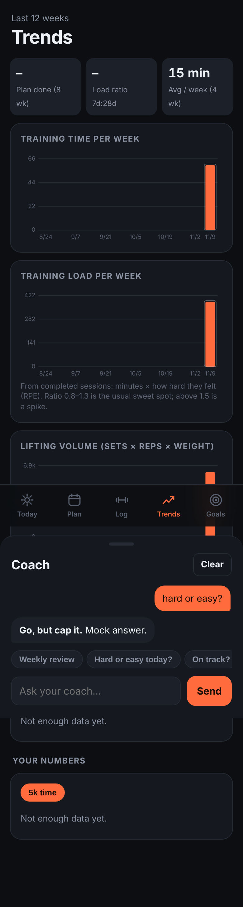

# Coach

A personal, phone-first training app that combines Garmin watch data with my own logs (lifts, PRs, other numbers) and my long- and short-term goals, and uses Claude to plan and adjust each week.

<p>
  
  
  
</p>

*Screenshots use sample data.*

## How it's put together

```
 iPhone / any browser                    Windows laptop
┌──────────────────────────┐            ┌───────────────────────────────┐
│  Coach page (app/)       │            │  Claude desktop app           │
│  hosted privately in my  │◄── sync ───│   └─ garmin-coach helper      │
│  Claude account          │  (when     │      (helper/, Python stdlib) │
│  • data: Claude storage  │  opened in │        │                      │
│  • AI coach: Claude      │  desktop   │        ▼                      │
└──────────────────────────┘  app)      │  Garmin Personal API (free,   │
                                        │  official, read-only)         │
                                        └───────────────────────────────┘
```

- **`app/index.html`**: the whole app in one self-contained file (HTML, CSS, JS, no build step). It's published as a private page in my Claude account, which gives it:
  - storage for goals, plans, lifts, numbers, recovery days and watch activities (owner-only),
  - the AI coach (weekly plan, weekly review, chat) through my Claude plan, with no API key,
  - a bridge to the local Garmin helper when opened in the Claude desktop app.
- **`helper/`**: a tiny local MCP server (`garmin_coach_mcp.py`, Python 3.10+ standard library only) that the Claude desktop app runs on my laptop. It reads activities, sleep, HRV, resting HR, Body Battery, steps and stress from Garmin's free Personal API. Setup: [`helper/SETUP-WINDOWS.md`](helper/SETUP-WINDOWS.md).
- **`docs/PLAN.md`**: product plan, decisions and roadmap.
- **`legacy/laptop-server/`**: the first version (a Python web server + PWA run from the laptop). Superseded; kept for reference.

## Screens

| Tab | What it does |
|---|---|
| Today | Readiness (from Garmin sync or morning check-in) + training load ratio, Sync Garmin, today's session with Done/Skip + RPE, week strip, goal progress, new PRs, recent watch activities, Ask coach |
| Plan | Week view, planned workouts, "Plan this week" with the AI coach (keeps my sessions), add to or replace my plan |
| Log | Lifts (sets × reps × weight, RPE), other numbers (5k time, bodyweight…), PR board with estimated 1RM |
| Trends | Training time and load per week, running km, lifting volume, HRV / resting HR / sleep / Body Battery, e1RM per lift, any logged number |
| Goals | Long-term goals → linked, measurable short-term goals with automatic progress |

## Updating the app

The live app is the page in my Claude account; this repo is the source copy. To change it:
1. Edit `app/index.html` (or ask Claude in the Garmin project to make the change).
2. Republish the page from Claude, then refresh it on the phone. Data is kept across updates.

The page must stay **private** (not shared by public link) for Claude to publish updates to it.

## Helper tools

| Tool | What it does |
|---|---|
| `garmin_sync(start_date, end_date)` | Activities + daily recovery data for a date range, normalized for the app |
| `garmin_status()` | Checks the Garmin key works |
| `garmin_get(path, params)` | One raw read-only GET to the Personal API, for troubleshooting field names |

Test from a terminal: `python helper/garmin_coach_mcp.py --test` (needs `garmin_key.txt` next to the script, or `GARMIN_PERSONAL_API_KEY` set).

## Privacy

- `garmin_key.txt` is git-ignored and must never be committed. It stays on the laptop.
- No personal data is stored in this repo. Training data lives in the private Claude page's storage.
